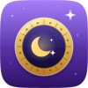
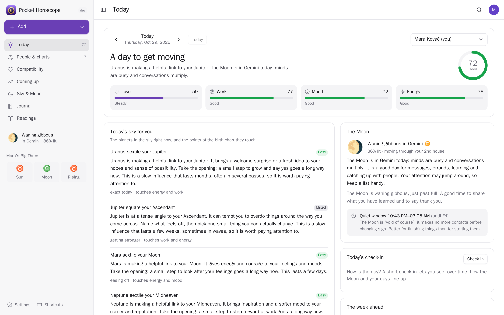
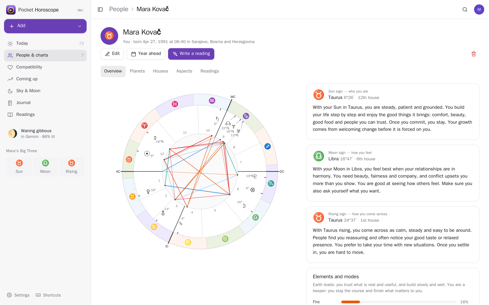
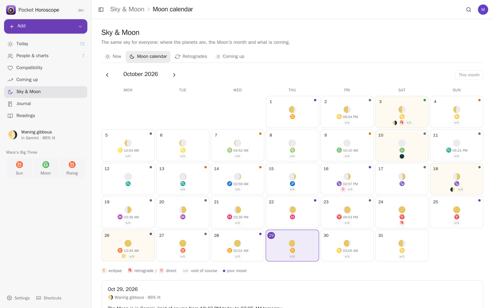
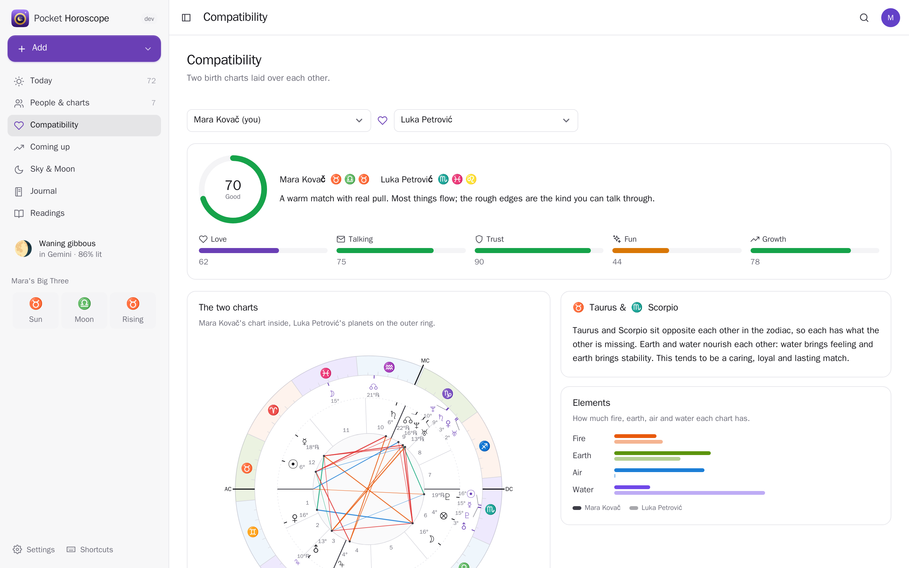
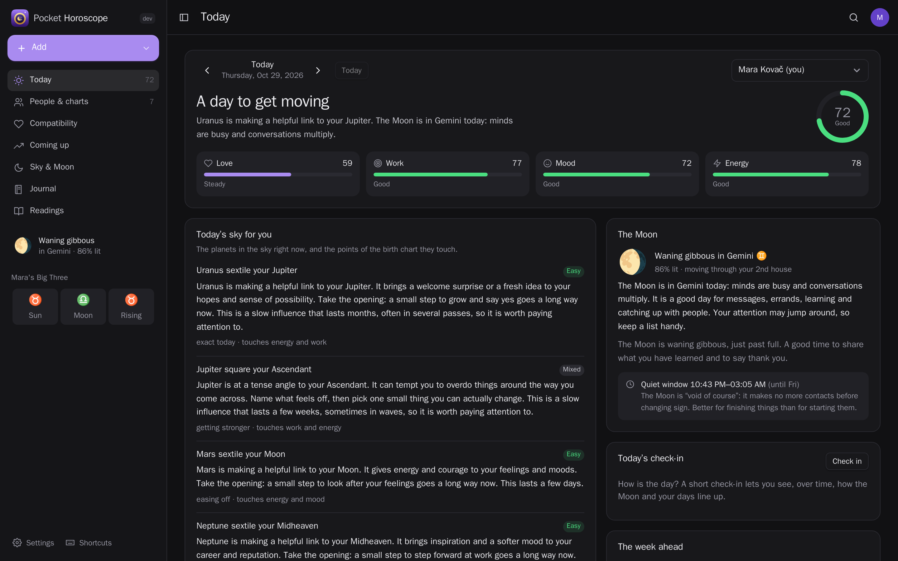
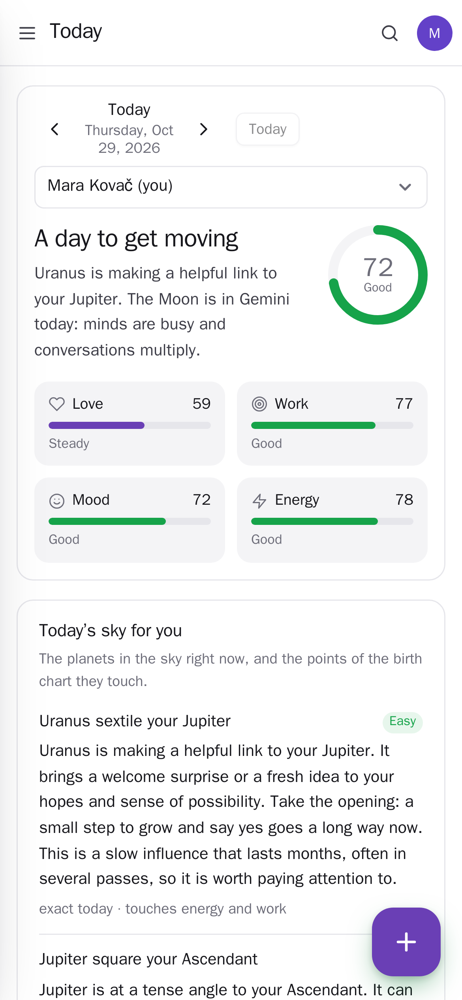
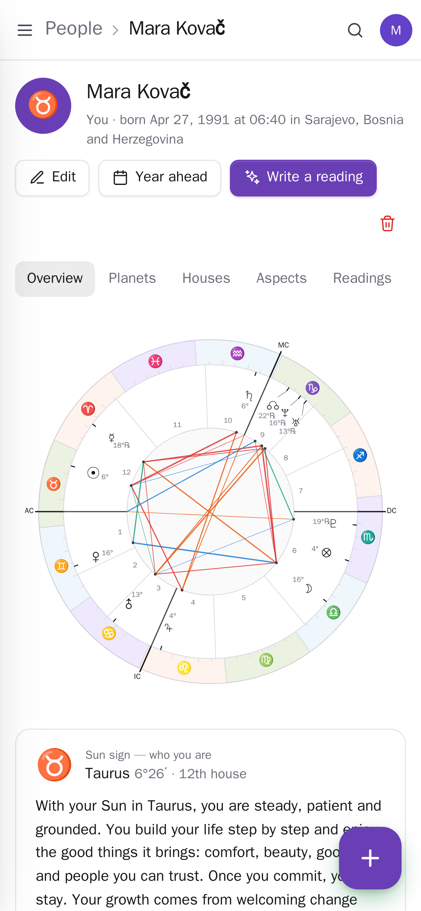

<p align="center"></p>
<h1 align="center">Pocket Horoscope</h1>
<p align="center">Astrology worked out from the real sky, on your own server. Your birth chart and the charts of the people you care about, with houses, aspects and plain-language readings; a daily horoscope made from today's planets against your own chart; compatibility between any two people; the Moon calendar with retrogrades, eclipses and void-of-course hours; the transits coming up; and a mood journal that shows whether the Moon really changes your days.<br>One Go binary, one SQLite file, one volume. Part of the Pocket apps; works on its own too.</p>
<p align="center">
  <a href="https://github.com/abjelosevic88/pocket-homelab-horoscope/actions"></a>
  <a href="https://github.com/abjelosevic88/pocket-homelab-horoscope/pkgs/container/pocket-homelab-horoscope"></a>
  <a href="LICENSE"></a>
</p>

---

<p align="center"></p>

<table>
  <tr>
    <td width="50%"></td>
    <td width="50%"></td>
  </tr>
  <tr>
    <td align="center"><sub>A birth chart: the wheel, the Big Three and a reading for every placement and aspect.</sub></td>
    <td align="center"><sub>The Moon calendar: every day's phase and sign, eclipses, retrogrades and your mood.</sub></td>
  </tr>
  <tr>
    <td width="50%"></td>
    <td width="50%"></td>
  </tr>
  <tr>
    <td align="center"><sub>Compatibility: two charts laid over each other, scored for love, talking, trust, fun and growth.</sub></td>
    <td align="center"><sub>Dark mode follows your system.</sub></td>
  </tr>
  <tr>
    <td width="50%"></td>
    <td width="50%"></td>
  </tr>
  <tr>
    <td align="center"><sub>On the phone: your day at a glance, a check-in a tap away.</sub></td>
    <td align="center"><sub>The chart wheel stays readable at phone size.</sub></td>
  </tr>
</table>

## What it does

- **Real positions, not tables**: the Sun, Moon and planets from VSOP87 and the Meeus lunar and Pluto theories, written in Go (no C, no data files): within a few arc-seconds of NASA JPL's DE421 for 1900–2050, the Moon within half an arc-minute. True lunar node, Lahiri sidereal zodiac if you prefer it, and Placidus, Koch, Whole sign, Equal or Porphyry houses.
- **Birth charts** for you and anyone you add: the wheel with houses and aspects, the Big Three, the balance of elements and modes, and a few plain sentences for every planet in its sign and house and every aspect. No birth time? You still get everything but the rising sign and houses, and it tells you when the Moon might be a sign off.
- **Your day**: today's planets against your chart, scored for love, work, mood and energy, with the transits that count explained, what to do and what to leave, the Moon's sign, phase and house, and the week ahead. Any day, past or future, for anyone you keep.
- **Compatibility**: two charts laid over each other (synastry), with the strongest links and the hard spots in words, and scores for love, talking, trust, fun and growth.
- **Coming up**: the transits of the next weeks or the whole year, with the exact days (up to three passes when a planet goes retrograde).
- **The sky**: where everything is right now, the Moon calendar (phases, signs, void-of-course hours, eclipses), the year's retrogrades and every ingress and station, in your own time zone.
- **Journal**: a daily check-in (mood, energy, a note) that keeps the day's sky with it; insights compare your mood with the Moon's phase, element and sign, and, with Pocket Health, your sleep and resting heart rate.
- **Written readings** (Pocket AI or your own OpenAI key): your day, a whole chart, a match, the year ahead, or any question — kept, deleted or saved to Pocket Notes.
- **Bring your people**: from Pocket Contacts (their birthdays), from an AAF file (astro.com, Solar Fire and most astrology programs) or a CSV. Place search finds the coordinates and the time zone of a birth place.
- **Notifications** through Apprise, ntfy or a webhook: your morning horoscope, new and full Moons, eclipses, planets turning retrograde or direct, and birthdays.
- **Everyone their own**: each person has their own people, journal, readings and settings; admins see no one else's.

## Run it

```sh
docker run -d --name pocket-horoscope -p 8080:8080 -v ./data:/data \
  -e BASE_URL=https://horoscope.example.com -e SECURE_COOKIES=true \
  ghcr.io/abjelosevic88/pocket-homelab-horoscope:latest
```

or `docker compose up -d` with [docker-compose.yml](docker-compose.yml). Open it, create the first account and add yourself. Place search uses [Open-Meteo's geocoder](https://open-meteo.com/en/docs/geocoding-api) (free, no key); set `GEOCODER_URL=off` to type coordinates by hand. All options: [docs/configuration.md](docs/configuration.md). API: [docs/api.md](docs/api.md). Backups: [docs/backup.md](docs/backup.md).

## With Pocket Core

Set `CORE_URL` and `CORE_REGISTRATION_KEY` and Horoscope joins the box: people sign in with Pocket Core, and through app links each person's horoscope reaches their own Pocket apps with nothing to paste: birthdays from Pocket Contacts (`contacts:read`), readings kept as notes in Pocket Notes (`notes:write`), sleep and heart rate from Pocket Health (`health:read`), written readings from Pocket AI. Other Pocket apps can read your day, the Moon and the sky, your coming transits and check-ins (`horoscope:read`: Pocket Day's journal, Pocket Calendar's overlay) — never the birth data of the people you keep — or add check-ins (`horoscope:write`). Events on the bus: `horoscope.daily_ready`, `horoscope.journal_logged`, `horoscope.person_added`. Without Core every connection can be made directly with a URL and a token; the Core-only choices stay visible, greyed out.

## Develop

```sh
make dev     # API on :8080 with demo data + Vite on :5173
make test    # go vet, go test, tsc
make         # web + binary
```

`internal/astro` is the ephemeris and chart engine (its tests compare against JPL DE421); `internal/astro/gen` rebuilds the truncated VSOP87 tables. `internal/content` holds every text the app shows. The demo people are made up. MIT licensed. VSOP87 by Bretagnon and Francou (IMCCE); the Moon, Pluto and nutation series from Jean Meeus' *Astronomical Algorithms* via [soniakeys/meeus](https://github.com/soniakeys/meeus) (MIT).
